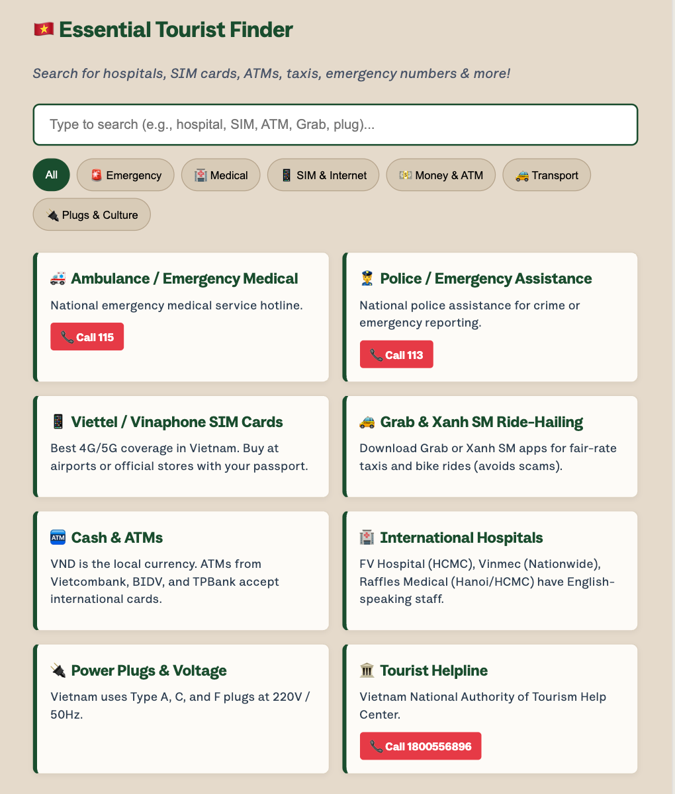
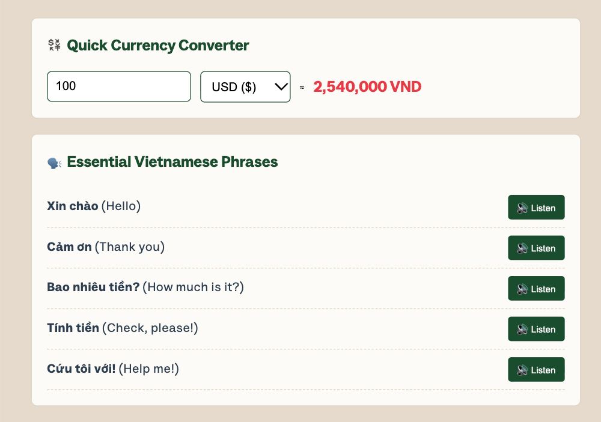

# 🇻🇳 Vietnam Travel Essentials & Cultural Guide

An interactive, responsive single-page web application designed for international tourists visiting Vietnam. The app offers real-time search for essential tourist services, language/audio learning tools, currency conversion, and cultural insights.

🚀 **Live Demo:** https://linhtruong309.github.io/VIEssentials_Web-Application/


## 📸 Screenshots

**Home**


**Tourist Finder**



**Currency Converter & Phrasebook**



## 🖥️ Run locally

```bash
git clone https://github.com/linhtruong309/VIEssentials_Web-Application.git
cd VIEssentials_Web-Application
open index.html   # macOS; or just double-click the file. No build step or dependencies.
```

## ✨ Features

- **Personalized Greeting:** Utilizes HTML5 `localStorage` to welcome users by name upon returning visits.
- **Interactive Gallery:** Toggle between nature and culture views with a single click.
- **Tourist Essentials Finder:** Real-time filtering and keyword search for hospitals, emergency numbers, SIM cards, transport options, ATMs, and plug types.
- **Audio Phrasebook:** Pronunciation helper for essential Vietnamese phrases powered by the **Web Speech API**. Requires a browser/OS with a Vietnamese (`vi-VN`) voice installed.
- **Responsive Layout:** Optimized for desktop, tablet, and mobile browsers.
- **Currency Converter:** Instant conversion from USD, EUR, GBP, JPY, KRW, and AUD to VND using fixed, approximate rates stored in `index.html` (not live exchange rates).

---

## 🛠️ Tech Stack

- **Frontend:** HTML5, CSS3 (Flexbox & CSS Grid)
- **Scripting:** Vanilla JavaScript (ES6+)
- **APIs & Web Capabilities:** Web Speech API, Web Storage API (`localStorage`)
- **Typography:** Custom Google Fonts (`Scoutie Sans`)

---

## 📂 Project Structure

```text
├── index.html
├── README.md
├── .gitignore
├── styles/
│   └── style.css
├── scripts/
│   └── main.js
├── images/
│   ├── Vietnam Nature.jpeg
│   └── Vietnam Culture.jpeg
└── screenshots/
    ├── home.png
    ├── finder.png
    └── tools.png
```
